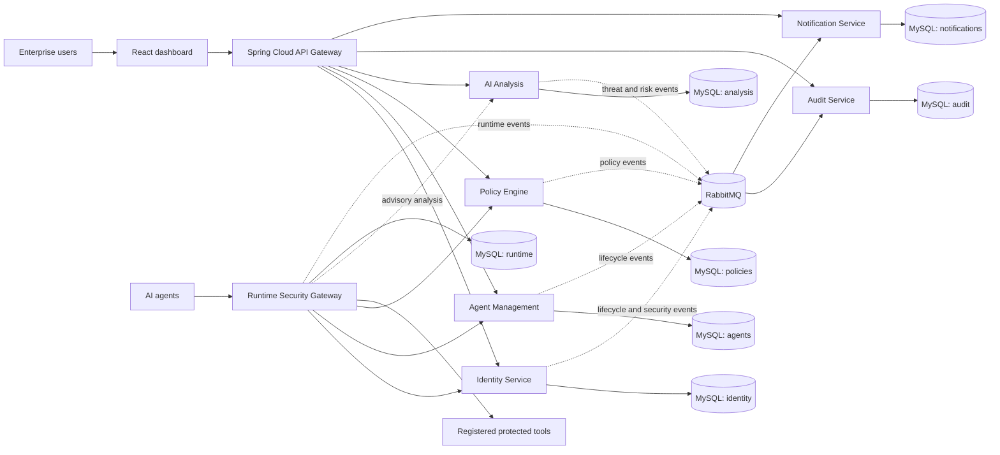

# AgentShield AI

AgentShield AI is an enterprise security platform for governing and monitoring AI-enabled applications and agents. It combines tenant-aware identity, deterministic policy enforcement, runtime request inspection, AI-assisted risk analysis, immutable audit history, and operator notifications.

AI analysis is advisory. It cannot make or override final authorization decisions; the Policy Engine remains the authorization authority, and the Runtime Security Gateway fails closed.

## Services

- Identity Service
- Agent Management Service
- Policy Engine
- AI Analysis Service
- Audit Service
- Notification Service
- API Gateway
- Runtime Security Gateway
- React administration dashboard

Each data-owning service has a dedicated MySQL database. Services exchange shared, versioned security events over RabbitMQ using transactional outboxes and idempotent inbox consumers.

## Architecture overview

The Identity Service issues user and agent identities. Agent Management owns agent registration; the Policy Engine makes deterministic ALLOW/DENY decisions; the Runtime Security Gateway validates agent identity, checks registered capabilities, asks Policy Engine, and executes only explicitly allowed requests against registered tools. AI Analysis produces advisory findings and trust scores and cannot authorize actions. Audit and Notification consume security events. The API Gateway is the browser-facing API boundary; the React dashboard uses OAuth Authorization Code with PKCE. Tenant identity comes from validated credentials and organization-scoped queries, never from caller-supplied organization or role headers.



Policy Engine decisions are deterministic and authoritative. AI Analysis is advisory only; the Runtime Security Gateway fails closed and never executes requests without an explicit `ALLOW`.

## Local infrastructure

The local Docker Compose stack, environment setup, internal service ports, database migrations, health checks, and troubleshooting steps are documented in [docs/infrastructure.md](docs/infrastructure.md).

Quick start after preparing `.env` as described in that guide:

```sh
docker compose --env-file .env -f infrastructure/docker/compose.yaml up --build -d
```

The dashboard is available at `http://localhost:3000`; the API Gateway is at `http://localhost:8080`. The Compose stack is for local development and does not replace production secret management, TLS termination, or deployment hardening.

## Deployment

The local Compose stack is not a production deployment. Deployment guidance and a separate constrained single-VM Compose profile are in [docs/deployment.md](docs/deployment.md). They preserve the existing local stack and distinguish a zero-cost target (subject to provider eligibility, capacity, DNS, and backup requirements) from production/high-availability needs. No cloud resources have been provisioned by this repository.

## Architecture and roadmap

- [Approved architecture](docs/architecture.md)
- [Development roadmap](docs/development-roadmap.md)
- [Infrastructure guide](docs/infrastructure.md)
- [Deployment preparation and operations](docs/deployment.md)
- [Deployment checklist](docs/deployment-checklist.md)
- [Backup and recovery guide](docs/backup-and-recovery.md)
